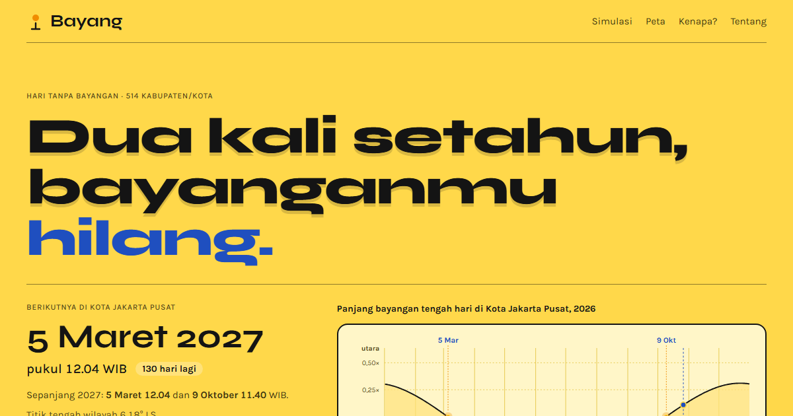

# Bayang



**[Buka Bayang](https://bayang.raffstw.my.id)**

Dua kali setahun matahari tepat di atas kepala dan benda yang berdiri tegak tidak punya
bayangan. Bayang menghitung tanggal dan jamnya untuk 514 kabupaten/kota di Indonesia,
semuanya langsung di peramban dari rumus posisi matahari.

- **Hari tanpa bayangan berikutnya** di daerahmu, dengan hitung mundur, plus grafik
  panjang bayangan tengah hari sepanjang tahun yang memotong nol dua kali.
- **Simulasi jam matahari**: tongkat dilihat dari atas, dengan arah dan panjang bayangan
  pada tanggal dan jam pilihanmu, lintasan ujung bayangan sepanjang hari, dan tombol untuk
  memutar satu hari penuh.
- **Peta 514 kabupaten/kota**: tanggal hari tanpa bayangan Februari–April dan
  September–Oktober, serta jam matahari terbit hari ini, yang memperlihatkan lompatan di
  perbatasan zona waktu.
- **Kenapa dua kali?** Deklinasi matahari sepanjang tahun dibandingkan pita lintang
  Indonesia.
- **Terbit dan terbenam** sepanjang tahun, dengan siang terpanjang dan terpendek.
- Setiap daerah punya tautan sendiri (`#daerah=kota-pontianak`).
- Tampilan siang bolong: latar kuning silau, panel dengan bayangan hitam jatuh tegak
  lurus ke bawah seperti benda di tengah hari.

## Perhitungan

Posisi matahari memakai algoritma NOAA Solar Calculator, yang berbasis *Astronomical
Algorithms* karya Jean Meeus, dengan ketelitian sekitar satu menit
([`src/matahari.ts`](src/matahari.ts)). Hari tanpa bayangan adalah hari ketika deklinasi
matahari saat kulminasi paling dekat dengan lintang setempat.

Untuk 514 daerah sekaligus, deklinasi harian dihitung sekali per tahun lalu diperhalus
hanya di sekitar perpotongan, jadi seluruh peta selesai dalam sekitar 20 ms. Hasilnya diuji
terhadap nilai yang sudah diketahui: Pontianak di khatulistiwa sekitar 21 Maret dan
23 September pukul 11.50 dan 11.35 WIB, Jakarta awal Maret dan awal Oktober, persamaan
waktu sekitar +16 menit di awal November.

Lokasi tiap daerah adalah titik tengah wilayahnya (batas wilayah geoBoundaries: BPS, WFP,
OCHA ROAP, CC BY 3.0 IGO); zona waktu ditentukan dari provinsinya. Jadwal resmi kulminasi
utama diterbitkan BMKG setiap tahun. **Jangan menatap matahari secara langsung.**

## Warna

Peta memakai skala urut satu rona biru teduh (#7fa9dd → #15346b), divalidasi ordinal
terhadap panel peta #fff6c8.

## Menjalankan

```
npm install
npm run dev
npm test        # posisi matahari, terbit/terbenam, hari tanpa bayangan (vitest)
npm run build
```

Vite + TypeScript, tanpa framework UI; grafik dengan d3-scale dan d3-shape, peta dengan
d3-geo dan topojson-client.
